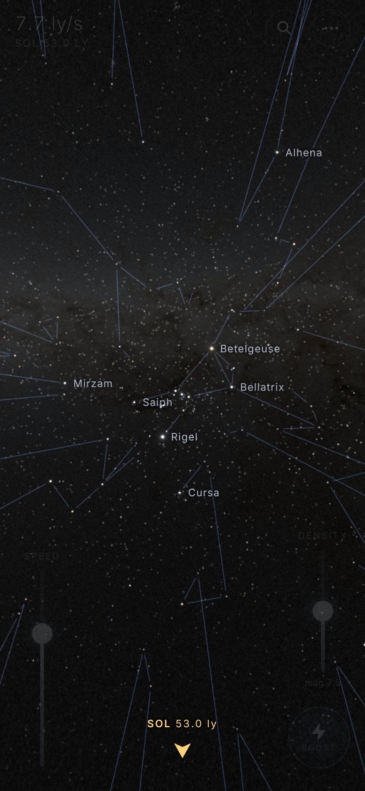
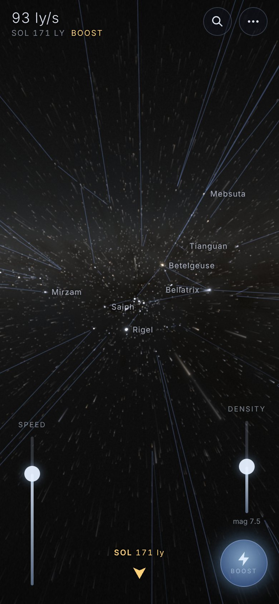
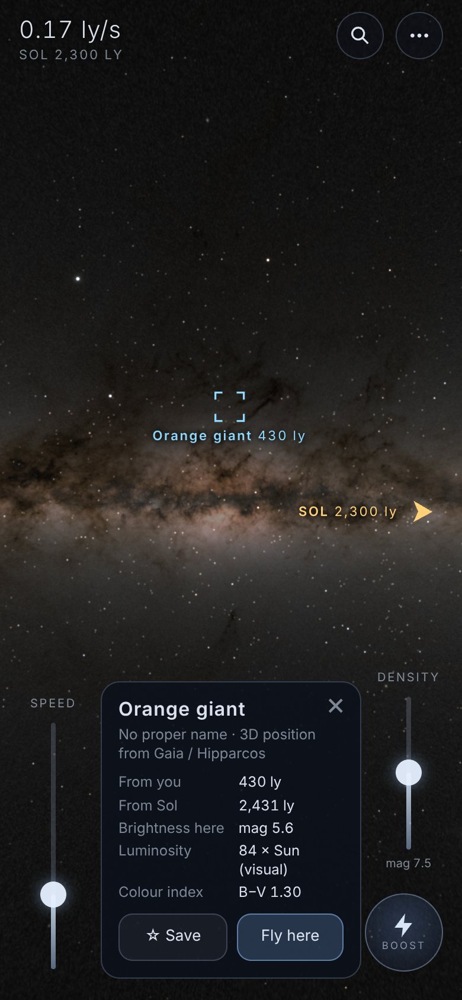
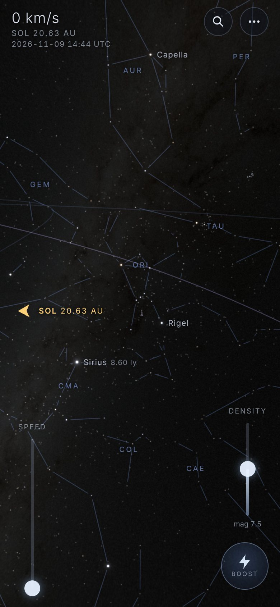
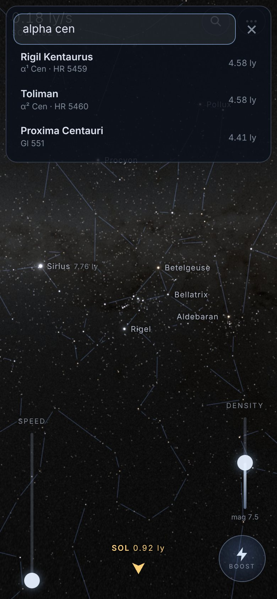
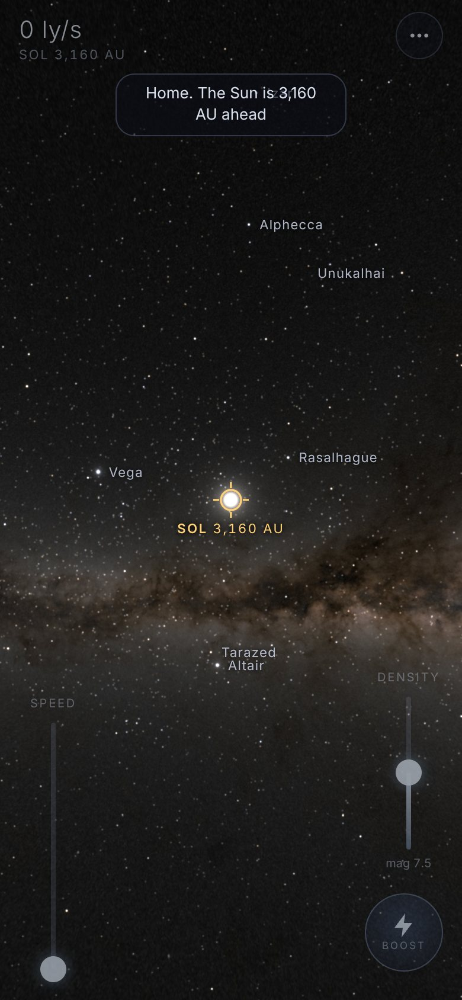
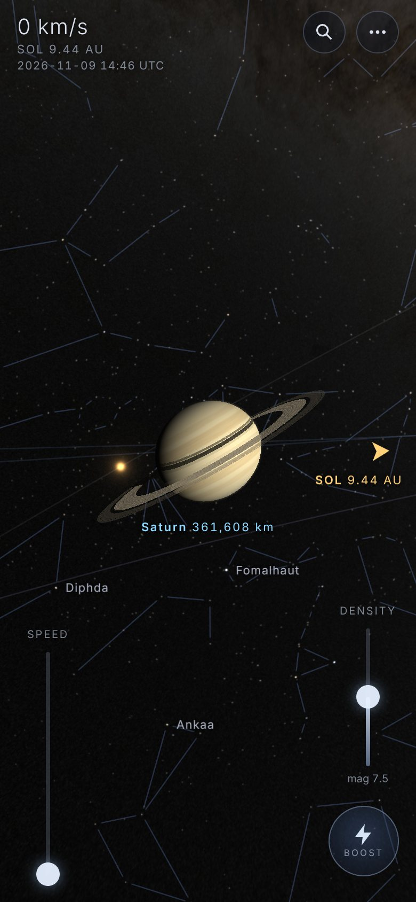
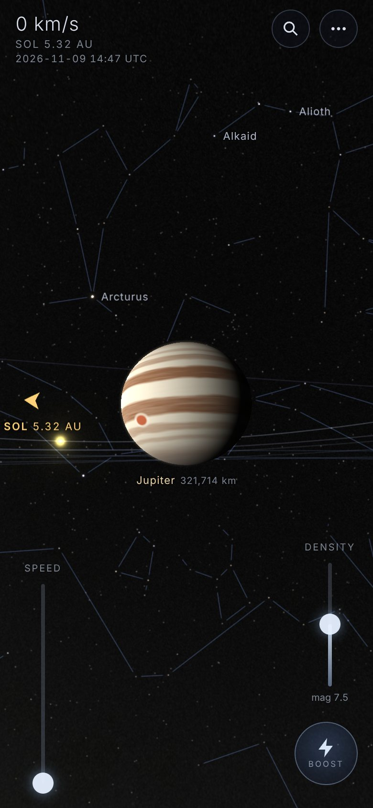
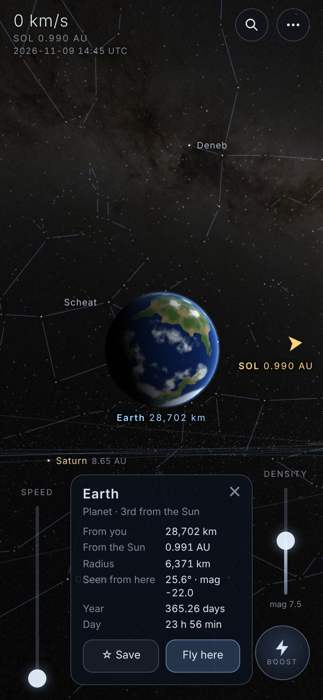

# Starfield Flight

Fly at warp speed through **625,664 real stars in 3D**: every point sits at its catalogued
3D position, and its brightness and colour come from the catalogue and from your distance to it.
A small gold marker always points to **Sol**, so you can find your way home, and home is a live
**Solar System**: the Sun, the planets, the Moon, Jupiter's Galilean moons, Titan and Pluto on
their real orbits for today's date. **Search** any star or planet by name or designation, keep
**favourites**, and show the **constellation figures** drawn between the stars' true 3D
positions. It runs at 60 fps on phones, fully offline, as an Android app (APK) or an installable
web app.

| Leaving the Solar System | Boost | 2,300 light-years out |
| --- | --- | --- |
|  |  |  |
| **Constellations** | **Search** | **Home: the Solar System** |
|  |  |  |
| **Saturn** | **Jupiter** | **Earth** |
|  |  |  |

## Install

**Android:** open the latest [release](https://github.com/SamPlatypus/Starfield-Flight/releases/latest)
on your phone, download `starfield-flight.apk`, open it and allow installing from that source
when Android asks. Every push to this repository builds and publishes a new signed APK that
installs as an update.

**Web / iPhone / desktop:** once GitHub Pages is enabled (see [CI](#ci-and-releases)) open the
site and tap **Install app** (the pill at the top, or Menu → Install). Chrome and Edge install it
as a full-screen app; on iPhone use Share → Add to Home Screen. After the first visit it works
with no connection. The same menu has a **Download Android APK** button.

## Flying

| Do this | To |
| --- | --- |
| Drag anywhere | Steer like a joystick: the further from where your finger went down, the faster you turn |
| Tap a star or planet | Turn towards it, see its name, distance, brightness and size, **☆ Save** it, or **Fly here** |
| Tap empty sky | Turn towards that point |
| Press and hold (or ⚡) | **Boost**: 6× speed, wider view, longer streaks |
| Pinch | Change speed |
| Twist two fingers | Roll |
| Speed slider (left) | Throttle, from all stop to ~200 light-years per second (logarithmic) |
| Density slider (right) | How faint a star you can see: limiting magnitude 4.5 (sparse) to 10.5 (dense) |
| Tap the **SOL** marker | Autopilot home: turns to the Sun, accelerates, and parks 6 AU from it on your own line of approach, the Sun in the middle of the view all the way (an approach near the planets' plane is lifted to 25° above or below it, so the orbits open out) |
| 🔍 | **Search** stars and planets: *Sirius*, *Alpha Centauri*, *α Cen*, *alf CMa*, *61 Cyg*, *HR 7001*, *Gliese 581*, *Jupiter*, *Titan*… (typos like *Betelguese* are forgiven); pick one to turn to it and open its card |
| Menu → Favourites | Your saved stars and planets with their distance from you, updated live: tap to fly there, ✎ to rename, × to remove (up to 100) |
| Menu (⋯) | Fly home, search, favourites, jump to a random star, all stop, hide controls, motion blur, Milky Way, field of view, star and planet names, constellation lines and names, orbits, the Solar System clock, install |

Keyboard: WASD or arrows steer, Q/E roll, Space or Shift boost, + / − speed, [ ] density,
H home, M menu, / search, F favourites, C hide controls, L names, K constellation lines,
N constellation names, Esc closes panels.

Controls fade to near-invisible after a few seconds; the view keeps the plane of the Milky Way
level (easing over to the planets' plane as you come in among them; turn this off in the menu
for free flight) and banks gently into turns. Distances read in light-years among the stars, in AU and km near
the Sun, and speeds in ly/s, AU/s or km/s to match.

## The Solar System

Within 0.2 light-years of the Sun the view fades into the Solar System: the starfield steps
back to about naked-eye depth and the planets, the asteroid belt and the orbits fade in.

- **Real positions for today:** the planets from JPL's Keplerian elements (Standish) with
  Schlyter's perturbations of Jupiter, Saturn and Uranus; the Moon from Meeus's lunar theory;
  Io, Europa, Ganymede, Callisto and Titan from JPL's mean satellite elements in their Laplace
  planes. Checked against astronomy-engine (VSOP87, ELP/MPP02, E5) from 1962 to 2064: planets
  within 3′, the Moon within 1′, the Galilean moons within about 2°.
- **Real sizes and spin:** every body is a ray-traced ellipsoid with its IAU radius, flattening,
  pole and rotation, lit from the Sun's true direction (so phases are right): Jupiter's belts,
  zones and Great Red Spot, Saturn's rings with their gaps and shadows, Earth's oceans,
  continents and clouds, the Sun's limb-darkened disc and corona. Too small to resolve, a body
  becomes a point as bright as its visual magnitude from where you are.
- **Flying among planets:** speed scales with the distance to the nearest body, so the default
  throttle crosses to it in about 7 seconds, and arriving at warp the ship drops out of warp at
  the edge of the Solar System instead of flashing through it. Near a planet or moon you move
  with it. **Fly here** parks on a body's sunlit side (as far as the approach allows) and keeps
  pace with it as it moves; you can't fly into anything. The autopilot looks at where it is
  going to stop and look, not at where it is going: the planet stays in the middle of the view
  while the ship slides round to its sunlit side, and nothing turns once it has stopped.
- **Arriving:** the way in is one hand-off, worked out in one place (`src/solar/transition.js`)
  from the distance to the Sun: the Sun's neighbourhood (0.2 light-years, where the ship drops
  out of warp), the planets resolving (2,000 to 150 AU, in log distance), the Solar System
  proper (inside 60 AU, announced when you fly in or out by hand) and the neighbourhood of a
  planet or moon. Each edge is left a quarter further out than it is entered, so nothing
  flickers at a boundary. The view's level swings from the galactic plane to the planets'
  plane, 60° apart, at no more than 15° a second; the autopilot starts that swing as it sets
  off, so the view has settled long before it arrives.
- **Clock:** the planets move in real time. In the menu, run the clock at up to a year per
  second, pause it, or go back to now (AD 1000–3000).

## Constellations

The 88 IAU constellation figures (d3-celestial) are drawn between the stars' real 3D positions,
faint and semi-transparent. Seen from the Sun they are the familiar figures; fly away and they
stretch and break apart, because constellations are only line-of-sight coincidences. Segments
fade as their stars dim with distance, and whole figures fade far from home. Constellation
names (IAU abbreviations) sit at the middle of each visible figure.

## What makes it real

- **Positions:** the [Yale Bright Star Catalogue](https://github.com/SamPlatypus/Star-Sky) used by
  Star Sky (all 8,404 stars to V = 6.5, with IAU names, Bayer/Flamsteed designations, V magnitudes,
  B−V colours and spectral types) is matched one-to-one (HR number, position, magnitude) to
  [AT-HYG v4.0](https://codeberg.org/astronexus/athyg), which supplies each star's distance from
  **Gaia DR3** or the **Hipparcos** new reduction: 8,398 Yale stars get a measured distance. Three
  hot stars whose parallaxes are unusable, among them Polis (μ Sgr), are placed by spectroscopic
  parallax and flagged as estimated in their info card; the recurrent nova T CrB and two Mira
  variables, which Yale lists at maximum light, are left out. AT-HYG adds the remaining 321,064
  Hipparcos/Tycho-2 stars to V = 10, and the **Gaia Catalogue of Nearby Stars** adds 296,198 faint
  neighbours (red and white dwarfs) to complete the census within 100 parsecs.
- **Brightness:** every frame, each star's apparent magnitude is computed from its absolute
  magnitude and its true distance to you, `m = M + 5 log10(d / 10 pc)`. From the Sun the sky
  reproduces the catalogue: Sirius −1.46, Canopus −0.72, Arcturus −0.04, Vega 0.03… Fly 8 light-years
  out and Sirius is a blazing −4.
- **Colour:** B−V → effective temperature (Ballesteros 2012) → the colour of a blackbody at that
  temperature through the CIE 1931 colour-matching functions → sRGB. Betelgeuse is orange, Rigel
  blue-white, the Sun a warm white.
- **Milky Way:** the unresolved glow of the Galaxy from NASA's *Deep Star Maps 2020* (the version
  with the Hipparcos and Tycho stars removed, since those are drawn in 3D), as a seamless cube map.
- The tests check distances (Sirius 2.64 pc, Betelgeuse 152.7 pc, Proxima 1.30 pc…), the sky from
  the Sun against the Yale magnitudes, the count of stars brighter than V 4, and that culling never
  drops a visible star.

Distances are only as good as the parallaxes: the bright giants beyond ~500 pc have large
uncertainties, and far from the Sun the catalogues only contain stars that are bright as seen
from Earth, so the sky thins out the further you go. The census within 100 pc is complete down to
the faintest red dwarfs.

## How it stays at 60 fps

- **No vertex buffers.** The catalogue lives in one RGBA32F texture (position in parsecs plus
  packed colour and absolute magnitude); `gl_VertexID / 6` picks a star and `% 6` a corner of its
  quad, so any contiguous range of stars is one draw call (`WEBGL_multi_draw` when available).
  Some mobile GPUs start `gl_VertexID` at 0 whatever the draw's offset, which redraws the first
  few hundred stars of the catalogue for every range. So the renderer starts by drawing each
  range from vertex 0 with its start in a uniform, which cannot go wrong, and moves to the
  single multi-draw call only after it has drawn real frames both ways and found them identical.
- **Magnitude-band octrees.** Stars are grouped into 1-magnitude bands of absolute magnitude, each
  with its own octree. A band is only searched within the distance where its brightest member
  can still be seen (`10^((m_lim − M + 5)/5)` pc), so faint red dwarfs come from the few nodes
  around you while supergiants come from the whole Galaxy, and nodes outside the view frustum
  (swept by the streak length, so stars that just flew past still draw their tails) are skipped.
  Typically 30,000–40,000 of the 625,664 stars are sent to the GPU.
- **Streaks are real motion blur.** Each star is a capsule from where it was a fraction of a second
  ago to where it is now, computed from the ship's velocity and rotation. Its light spreads along
  the streak; boosting lengthens the exposure.
- **Precision:** the ship's position is float64 in JavaScript; the GPU gets it as a float32
  high/low pair, so `(star − high) − low` stays exact near any star, even 3,000 pc from the Sun.
- **Adaptive quality:** a governor watches frame times and lowers render resolution first, then
  the faintest magnitude drawn, if a device cannot hold 60 fps, and gives quality back when there
  is headroom. The canvas is capped at 2× device pixels.
- **The Solar System costs almost nothing:** positions for every body take ~15 µs per frame,
  each body is one screen-space quad that ray-traces its ellipsoid, orbits are instanced line
  segments clipped to the view, and the 6,000-particle asteroid belt solves Kepler's equation in
  the vertex shader. None of it touches the star pass.
- Nothing allocates per star per frame, the HUD moves with compositor-only transforms, the app
  pauses in the background, and WebGL context loss is recovered.

## Development

```sh
npm install
npm run dev          # Vite dev server
npm test             # unit tests (catalogue, ephemerides, search, favourites, culling, flight model)
npm run build        # production build in dist/ + offline service worker
npm run test:e2e     # headless Chromium: rendering, touch controls, search, favourites, Solar System, offline start
```

Append `?stats` to the URL (or enable *Performance overlay* in the menu) to see frame rate, stars
submitted, draw calls, the star draw path in use (`multi-draw`, `draw-loop` or `base-uniform`),
the app version, how the faster paths compared with the safe one, and where the ship is in the
hand-off to the Solar System (state, and how far the planets and the view's level have come in). Tapping the overlay steps
through the draw paths (automatic, then each one forced); `?stardraw=multi|loop|base` does the
same from the URL, and `?fixed` pins the render quality.

### Android

Requires JDK 21 and the Android SDK (platform 36, build-tools 36).

```sh
npm run android:sync                      # build the web app and copy it into android/
cd android && ./gradlew assembleRelease   # -> app/build/outputs/apk/release/app-release.apk
```

The Android shell is Capacitor 8: sticky immersive full screen, screen kept on while flying,
edge-to-edge under display cutouts, haptics on boost and arrival, back button closes panels.

### Signing

Release APKs are signed with `ANDROID_KEYSTORE_FILE` / `ANDROID_KEYSTORE_PASSWORD` /
`ANDROID_KEY_ALIAS` / `ANDROID_KEY_PASSWORD` when set, otherwise with the development key in
`android/keystore/` so that every build from this repository installs and updates out of the box.
That key is public. To sign with your own key, create one and add it as repository secrets:

```sh
keytool -genkeypair -keystore release.p12 -storetype PKCS12 -alias starfield -keyalg RSA -keysize 2048 -validity 10000
base64 -w0 release.p12    # -> secret ANDROID_KEYSTORE_BASE64
```

plus `ANDROID_KEYSTORE_PASSWORD`, `ANDROID_KEY_ALIAS` and `ANDROID_KEY_PASSWORD`. Android only
installs updates signed with the same key, so uninstall a dev-key build once after switching.

### CI and releases

`.github/workflows/build.yml` runs on every push:

1. **web** – unit tests, production build, end-to-end tests in headless Chromium (screenshots
   are kept as an artifact);
2. **android** – Capacitor sync and Gradle release build, signature check, then the APK is
   uploaded as an artifact and published as a GitHub Release `v1.1.<run>` with
   `starfield-flight.apk` (the in-app download link always points at the latest one);
3. **pages** – deploys the installable offline web app to GitHub Pages. Enable it once in
   *Settings → Pages → Source: GitHub Actions*; until then the job just leaves a notice.

### Rebuilding the data

```sh
bash tools/fetch-sources.sh        # AT-HYG, GCNS (Gaia TAP), NASA Milky Way map -> tools/raw/
node tools/build-stars.mjs         # -> public/data/stars.bin, names.json, search.json, constellations.json
pip install numpy pillow OpenEXR
python3 tools/build-milkyway.py tools/raw/milkyway_2020_4k.exr public/sky
node tools/make-icons.mjs          # app icons (PWA + Android)
```

`tools/sources/yale/` holds the Yale extract from Star-Sky. The build prints how every source
was merged (matches, double-star components folded into Yale's combined magnitudes, duplicates
removed) and the quantisation error of the compressed positions (< 800 AU).

## Project layout

```
index.html, src/styles.css   app shell, HUD and controls
src/app.js                   loading, frame loop, commands
src/catalog.js               decoder for public/data/stars.bin
src/culling.js               magnitude-band octree + frustum culling
src/flight.js                ship physics, steering, levelling, boost, autopilot
src/solar/                   ephemerides, body data, Solar System state and view, the interstellar hand-off
src/search.js, src/favourites.js, src/constellations.js   search index, favourites, figures
src/render/                  WebGL2 renderer, shaders, blackbody colours, Solar System pass
src/hud.js, src/controls.js, src/panels.js, src/input.js   markers, labels, sliders, panels, touch/mouse/keys
src/perf.js                  frame-rate governor
src/install.js, src/platform.js   PWA install / APK link, Capacitor bridges
public/data, public/sky      generated star catalogue, search index, figures, Milky Way cube map
android/                     Capacitor Android project (Gradle)
tools/                       data, icon and service-worker builders
test/                        unit tests and the end-to-end test
```

## Credits

Star data, imagery, constellation figures and the orbital theories, with their licences, are
listed in [NOTICE.md](NOTICE.md). The star data files in `public/data` are derived from AT-HYG
and are shared under CC BY-SA 4.0.
